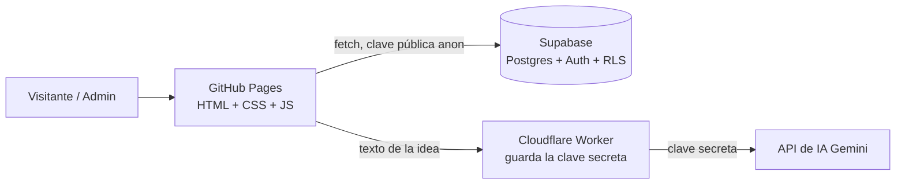

# Arquitectura de The Crochet Lab

## Diagrama

## Decisiones

| Capa | Elección | Motivo | Alternativa descartada |
|---|---|---|---|
| Hosting | GitHub Pages | Lo exige el proyecto; es estático | — |
| Frontend | HTML, CSS y JS con módulos, sin librerías ni compilación | Sin rutas rotas en Pages, fácil de estudiar y explicar | React + Vite (más piezas sin necesidad aquí) |
| Datos y login | Supabase (Postgres, Auth, RLS) | Base real y autenticación sin servidor propio | Firebase (otro modelo de datos, menos SQL) |
| IA | Cloudflare Worker + API de Gemini | La clave vive en el Worker, nunca en el navegador | Llamar a la IA desde el navegador (expone la clave) |

## Modelo de seguridad

- El repositorio es público (requisito de GitHub Pages gratis): nada secreto se sube nunca.
- La clave `anon` de Supabase es pública por diseño. Lo que protege los datos son las reglas RLS de `supabase/schema.sql`.
- Solicitudes: cualquiera inserta, solo el admin lee. Productos: cualquiera lee los activos, solo el admin escribe.
- Admin: tabla `admins` + función `is_admin()`. No hay contraseñas en el código.
- La clave de IA se guarda como secreto del Worker. El Worker solo recibe el texto de la idea, sin nombre ni contacto del cliente.

## Límites y riesgos verificados (noviembre 2026)

| Servicio | Dato | Qué significa para el proyecto |
|---|---|---|
| Supabase gratis | Pausa el proyecto tras 7 días sin actividad; 500 MB de base de datos, 1 GB de archivos, 50.000 usuarios activos al mes | **Abrir el sitio o el panel de Supabase la semana de la defensa.** Si se pausa, el catálogo deja de cargar hasta restaurarlo. |
| Cloudflare Workers gratis | 100.000 solicitudes por día y 10 ms de CPU por invocación (la espera de red no cuenta) | Sobra para un asistente pequeño. Pasado el tope las peticiones fallan hasta las 00:00 UTC, así que el asistente debe mostrar un mensaje de respaldo. |
| Gemini API gratis | Límites por modelo visibles solo en la consola de AI Studio; Google puede usar las peticiones gratuitas para mejorar sus productos | No enviar datos personales a la IA. Elegir el modelo en la Fase 7 según lo disponible entonces. |
| GitHub Pages | 1 GB de sitio, 100 GB de ancho de banda al mes (límite blando); no sirve para vender en línea ni mover pagos | Este sitio solo muestra catálogo y recibe solicitudes, sin pagos. Para vender con pagos habría que cambiar de hosting. |

## Flujo de datos

1. Catálogo: `products.js` pide `productos` activos a Supabase; sin configuración usa los de ejemplo.
2. Pedido: `pedido.js` valida en el navegador y hace INSERT en `solicitudes`; la base valida de nuevo con sus restricciones.
3. Admin (Fase 6): login con Supabase Auth, y el token de sesión se envía en cada petición.
4. Asistente (Fase 7): navegador → Worker → Gemini → respuesta y resumen del pedido.
